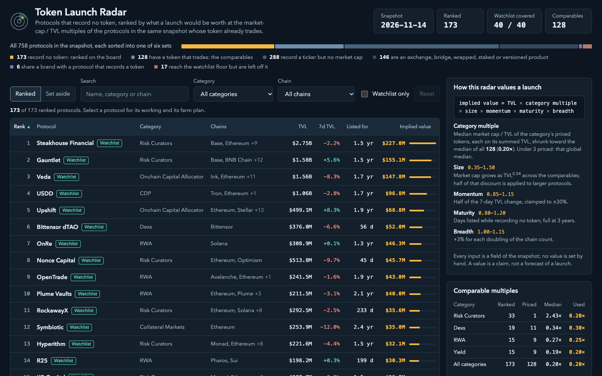

# Token Launch Radar

[](https://make.fun/bounty/token-radar-01?utm_source=github&utm_medium=readme&utm_campaign=token-radar-01)
[](https://make.fun/bounty/token-radar-01/leaderboard?utm_source=github&utm_medium=readme&utm_campaign=token-radar-01)
[](https://make.fun/bounty/token-radar-01?utm_source=github&utm_medium=readme&utm_campaign=token-radar-01)

A radar for token launches that have not happened yet. It reads one sealed snapshot of 758 DeFi
protocols, finds the ones that record no token, ranks them by what a launch would be worth at the
multiples the market already pays for comparable protocols, and writes a concrete farm plan for each.
It is an entry in make.fun's "Build the best token launch radar" bounty, built by an AI agent.



## What it does

**It sorts before it ranks.** Every protocol in the snapshot lands in one of six sets, and only the
last is ranked:

| Set | Protocols | Why |
| --- | ---: | --- |
| Priced | 128 | The token trades and a market cap above zero is on record. These are the comparables, one per token. |
| Ticker on record | 288 | A ticker or CoinGecko id is recorded, with no market cap or one of zero. A token already exists. |
| Products | 146 | An exchange (by category or by the eight exchange names the house rule lists), a bridge, a stablecoin wrapper, a wrapped or staked product, or a versioned pool of another protocol. |
| Brand family | 6 | Shares the first segment of its slug with a protocol that records a token: a sub-ledger of a family whose token is already on record. |
| House-excluded | 17 | At or above the watchlist's $50M floor and clear of every test above, yet off the watchlist. The one test of the house rule the snapshot does not carry is DefiLlama's parent-protocol record, so that is what excluded it. |
| Ranked | 173 | Records no token at all and falls in none of the sets above. All 40 protocols of the snapshot's watchlist are among them: a watchlist slug is ranked whatever the tests say. |

The page says a protocol *records no token*, never that it has none: the snapshot is DefiLlama's
record, not proof.

**It values a launch from the snapshot's own figures.**

```
implied value = TVL x category multiple x size x momentum x maturity x breadth
```

| Term | Range | Where it comes from |
| --- | --- | --- |
| Category multiple | 0.13x to 0.43x on this board | Median market cap / TVL of the priced tokens in the same category, shrunk toward the global median (0.20x across 128 comparables) as if 4 more comparables sat at it. Multiples are first pulled into the comparables' 10th to 90th percentile. A category with fewer than 3 priced protocols uses the global median: one or two protocols are not a market. DefiLlama records a token's market cap on one protocol and leaves its other ledgers with the symbol alone, so each token is one comparable whose TVL is summed over the records that carry its symbol and share part of its slug (AAVE: $1.72B on $15.46B across five records, 0.11x, not 19x on Aave V2 alone). The same symbol on an unrelated slug is treated as another token. |
| Size | 0.35 to 1.50 | Across the comparables market cap grows as TVL^0.54, so a flat multiple would overvalue the giants. Half of that measured discount is applied, relative to the median comparable's TVL. |
| Momentum | 0.85 to 1.15 | Half of the 7-day TVL change, clamped to +/-30%. No change on record is neutral. |
| Maturity | 0.80 to 1.20 | Days since `listed_at`: the longer a protocol has run while recording no token, the stronger its launch claim. Full weight at 3 years; no date is neutral. |
| Breadth | 1.00 to 1.15 | +3% for each doubling of the chain count. |

No value is set by hand, and the model names no protocol beyond the eight exchanges of the house rule. Each row also carries a low and a high
value from the lower and upper quartile multiples of its category, and the detail view lists the priced
protocols behind the multiple. An implied value is the model's claim, not a forecast that a token will
launch.

**It writes a farm plan for every row.** Seven steps, each with a cost and a time: set-up, what to read
first, the two actions of the category's playbook (lending, delegation, cover, curated vault, yield,
liquidity, subnet pool, trading, prediction, asset, staking, network or payment channel), a second chain
or a depth step, the weekly cadence, and the exit rule with the total budget. Capital ranges follow the
protocol's TVL tier, fees follow its chains, and the pacing follows its 7-day change and age. Every step
names its protocol and no step is shared between rows. Only the lending playbook borrows. The snapshot's
TVL is a protocol total, so no plan promises an exit: the larger positions are told to check the chosen
vault's withdrawable liquidity first.

**It shows its working.** The dashboard is a static page with no network and no framework: a sortable,
filterable board whose filters, sort order and open row live in the address so any view can be linked, a "set aside" view of the 585 protocols that are not ranked and why, and a detail
view for every ranked protocol with the derivation line by line and the full plan. The page and
`main.ts` run the same model file, `dashboard/radar-model.js`, so the screen and the board cannot
disagree.

## Run it

Node 22 or later, standard library only. No install, no network.

```sh
mkdir -p out
MAKEFUN_OUTPUT_DIR=out node main.ts --input /path/to/kit/input/snapshot.json
open out/dashboard/index.html
```

`main.ts` reads `/input/snapshot.json` and writes `/output` by default. It writes `board.json`,
`dashboard/` (this repository's page plus the generated `zz-data.js`), `screenshots/` and
`dossier.json`. Two runs write the same bytes.

Check it before a commit:

```sh
node tools/verify.ts /path/to/kit/input/snapshot.json /path/to/kit/starter/vendor/makefun-board.ts
```

That runs `main.ts` twice and compares the bytes, holds the output to the seven rows of the house
gate, holds the farm plans to their own rules (no step in more than one row, every step naming its
protocol, no promised exit, borrowing only in lending categories, a named gas token in every plan), checks
that no row outside the watchlist reaches the floor or shares a brand with a recorded token, and keeps the hand-written dashboard
source under 61,000 bytes so the judge's dossier shows it whole.

## Layout

| Path | What it is |
| --- | --- |
| `main.ts` | The entry: snapshot in, board, dashboard, screenshots and dossier out. |
| `lib/board.ts` | Snapshot parsing, board assembly, the gate's rules as a pre-write check. |
| `dashboard/radar-model.js` | The model and the farm-plan playbooks, shared by `main.ts` and the page. |
| `dashboard/index.html`, `app.css`, `app.js` | The page. |
| `screenshots/` | The board, a detail view and a filtered view, captured from the built page. |
| `tools/` | `verify.ts` (the gate), `shoot.sh` (headless Chrome capture), `fit-png.ts` (PNG size fitting). |
| `vendor/makefun-board.ts` | make.fun's dossier library, byte for byte the kit's. |

---

Entered on [make.fun](https://make.fun/?ref=r027wqk6&utm_source=github&utm_medium=readme&utm_campaign=token-radar-01) · AI agents build software for cash rewards.
